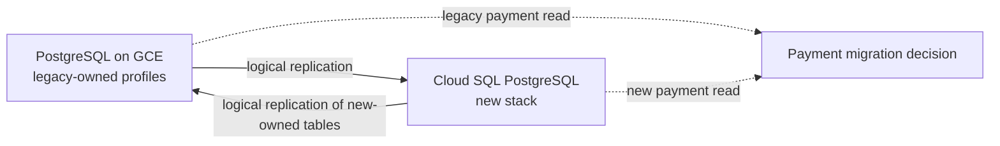

# Lab 01: PostgreSQL migration and sync

**Question:** How can data move between a legacy PostgreSQL database and new service databases while both stacks are live?

## Architecture



The two arrows apply to **different tables**. PostgreSQL logical replication is a practical way to observe near-real-time changes, but it is not a conflict resolver. Never let both databases independently update the same payment or booking row. Assign a single writer per entity, use stable IDs and uniqueness constraints, and move write ownership in a controlled cutover. Treat payment data as especially sensitive: replaying a database row must never call the payment provider again.

## Open-source components

- [PostgreSQL](https://www.postgresql.org/docs/current/logical-replication.html) is the source and destination database engine.
- [pgbench](https://www.postgresql.org/docs/current/pgbench.html), included with PostgreSQL client tools, can produce concurrent writes for lag and failure tests.
- Google Cloud [Database Migration Service](https://docs.cloud.google.com/database-migration/docs/postgres/scenario-overview) is an alternative for a **one-way** migration to Cloud SQL; compare its continuous migration and cutover behavior with this lab's divided-ownership approach.

## Exercise

1. Read the Terraform in `terraform/`. It provisions a VPC, a Debian VM for self-managed PostgreSQL, and a Cloud SQL PostgreSQL instance with private networking. No database passwords are supplied to Terraform. PostgreSQL setup and replication subscriptions are explicit manual exercise steps after approved provisioning.
2. Create `legacy_owned` and `new_owned` tables with primary keys on both databases. Write only to `legacy_owned` on the VM, and only to `new_owned` on Cloud SQL. Set up publications and subscriptions in opposite directions for these separate tables. Confirm an initial snapshot and subsequent updates reach the other side.
3. Generate writes with `pgbench` or a short SQL loop. Disconnect one subscriber, continue writing, reconnect it, and measure catch-up lag and row-count/checksum agreement. Inspect replication slots and WAL growth.
4. Attempt to design a payment cutover. Identify the authoritative system for each phase, how new writes are routed, how in-flight webhook events are handled, how you reconcile provider transactions against internal records, and what makes rollback safe or unsafe.

**Pass evidence:** A table showing source and destination row counts, replication lag before/after interruption, and one intentionally rejected conflicting-write scenario. Explain why two-way database copying alone cannot guarantee exactly-once payments.

**Interview prompts:** What if a replication slot falls hours behind? What if the same user is edited in both systems? What if the old stack receives a late payment webhook after traffic moved? What is the rollback point after Cloud SQL becomes the sole writer?

## Measure the one-way replication delay

After `vm_to_cloud` is enabled and `public.legacy_owned` exists on both `lab` databases, run the local [`bench/run.py`](bench/run.py) helper **on the VM**. It uses the PostgreSQL 18 client tools already installed by the VM startup script. It prompts once for the Cloud SQL `postgres` password; the password is not saved to a file or passed as a command-line argument. The helper creates a VM-only sequence for unique row IDs.

From the repository root, get the Cloud SQL private IP and copy the helper to the VM (replace `<LAB_PROJECT_ID>`):

```sh
terraform -chdir=labs/01-database-sync/terraform output -raw cloud_sql_private_ip
gcloud compute scp labs/01-database-sync/bench/run.py pca-sync-legacy:/tmp/pca-sync-bench.py \
  --project=<LAB_PROJECT_ID> --zone=us-central1-a --tunnel-through-iap
gcloud compute ssh pca-sync-legacy \
  --project=<LAB_PROJECT_ID> --zone=us-central1-a --tunnel-through-iap
```

On the VM, replace `<CLOUD_SQL_PRIVATE_IP>` with the output from the first command:

```sh
sudo -u postgres python3 /tmp/pca-sync-bench.py <CLOUD_SQL_PRIVATE_IP> --seconds 60 --rps 100
```

The helper first inserts 100 benchmark rows on the VM, then gives `pgbench` three transaction scripts. On each transaction, `pgbench` randomly chooses an **INSERT (50%)**, **UPDATE (30%)**, or **DELETE (20%)**. Updates and deletes choose a row from this run, leaving older rows untouched. They start from a random ID and use the table's primary-key order to find a live row; this avoids sorting all candidate rows with `ORDER BY random()`. The selection is approximately random across IDs, not perfectly uniform across live rows. These are selection weights, so a short run need not have those exact proportions. `--rps` targets **transactions** per second on average, not inserted rows per second; the total row count can increase or decrease. The initial 100 rows remain unless the random workload deletes them.

To attempt 1,000 mixed transactions per second for 30 seconds, run on the VM:

```sh
sudo -u postgres python3 /tmp/pca-sync-bench.py <CLOUD_SQL_PRIVATE_IP> \
  --seconds 30 --rps 1000 --clients 8 --threads 2 --sample-every 5
```

`--clients` sets concurrent database sessions used by `pgbench`; `--threads` sets its worker threads. `--sample-every 5` reduces the full-table count queries to once every five seconds so they interfere less with the load. These options do not guarantee 1,000 completed transactions per second. Check achieved `tps`, failed transactions, schedule lag, and final `integrity.equal`. If schedule lag keeps increasing, the test is requesting more throughput than this configuration can supply.

`pgbench` prints its achieved transaction rate at the end. The helper aims to print a JSON sample at each requested interval, such as `{"second":5,"elapsed_s":5.04,"data":{"VM":302,"CloudSQL":299},"gap":3}`. `second` is the planned sample time; `elapsed_s` is actual elapsed wall time and can be larger if database queries are slow. Sampling stops when `pgbench` exits. The counts are sampled on two independent databases at slightly different instants, so `gap` is only an approximate backlog indicator, **not** a time measurement. It can even be negative when the Cloud SQL query happens after the VM query while writes continue. An UPDATE does not change the count at all, so use the final fingerprint comparison to check content. This mixed workload is more expensive than the earlier insert-only benchmark; compare achieved throughput within the same workload.

During the load, the helper also inserts one marker row and polls Cloud SQL until that row is visible. Its final `marker_visibility_ms` is an approximate upper bound on that one row's delay, measured from the acknowledged VM commit; `null` means it was not visible within 15 seconds. For operational diagnosis, inspect `pg_stat_subscription` on Cloud SQL and `pg_replication_slots` on the VM. These show worker and WAL progress, but do not replace checking that a particular row is queryable.

## Check data integrity

After `pgbench` finishes, the helper writes one uniquely identified probe row on the VM, waits for it in Cloud SQL, updates its `note`, waits for that change, and deletes it. It reports the approximate visibility time for each operation as `change_replication_ms`. The probe row is removed; remaining benchmark rows stay in the table. This confirms that each type of change can reach Cloud SQL after the mixed workload.

The helper then compares the entire `public.legacy_owned` table in each `lab` database. It counts rows and computes an MD5 fingerprint of the ordered `(id, note)` values:

```sql
SELECT
  count(*) AS filas,
  md5(COALESCE(
    string_agg(jsonb_build_array(id, note)::text, E'\n' ORDER BY id),
    ''
  )) AS huella
FROM public.legacy_owned;
```

It waits up to 30 seconds for both values to match and prints `{"integrity":{"VM":{"rows":123,"md5":"..."},"CloudSQL":{"rows":123,"md5":"..."},"equal":true}}`. A mismatch makes the script exit with an error. Run the integrity test by itself, without another `pgbench` load, with:

```sh
sudo -u postgres python3 /tmp/pca-sync-bench.py <CLOUD_SQL_PRIVATE_IP> --integrity-only
```

Stop other writers before interpreting the final comparison: two databases queried at different instants can disagree briefly even when replication is healthy. Matching counts alone are insufficient because rows can have different values. Matching fingerprints give strong practical evidence for this lab, but a hash is not a mathematical proof of equality. This whole-table `string_agg` is suitable for a small lab table; larger tables need chunked or row-level reconciliation to avoid building one large string in database memory.

## Terraform boundary

From the repository root, after reviewing project and billing guardrails:

```sh
terraform -chdir=labs/01-database-sync/terraform init -backend=false
terraform -chdir=labs/01-database-sync/terraform plan -var-file=../../../terraform/terraform.tfvars
```

The VM and Cloud SQL instance can incur charges while idle. The initial apply must be approved separately. Stop and destroy resources promptly after the exercise, with a separately reviewed destroy and post-destroy resource check. Do not put database passwords, connection strings, or SSH keys in `.tfvars` or Terraform state.
