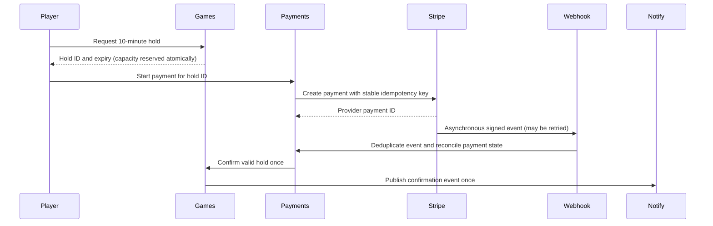

# Lab 02: identity, payment retries, webhooks, and refunds

**Question:** How can a booking be paid and confirmed once when clients retry and payment notifications are asynchronous?

## Components

- [Keycloak](https://www.keycloak.org/getting-started/getting-started-docker) is an open-source local identity provider for test users and JWT validation. It represents the external authentication provider in the interview; it is not part of the payment ledger.
- [Stripe's open-source one-time Checkout sample](https://github.com/stripe-samples/checkout-one-time-payments) provides a test payment UI and server. Clone it outside this repository, use only Stripe test mode, and inspect its chosen server implementation before modifying it.
- [Stripe CLI](https://docs.stripe.com/webhooks) forwards test webhooks to localhost. Keep Stripe keys and webhook signing secrets outside this repository and out of Terraform state.
- Terraform provisions a Pub/Sub topic and subscription for notification events. A local subscriber can observe notifications; sending real email or push is an optional later step.

## Flow to draw



The **games service** must atomically enforce capacity for 14–22 spots and expire holds. The **payments service** records a durable payment attempt before calling Stripe, uses one idempotency key per logical attempt, and keeps a unique provider payment ID and webhook event ID. The webhook verifies the signature using the raw body, records each event ID once, and returns success for an already processed event. A notification is an effect of a committed state transition, preferably via an outbox; it must not be the source of truth for payment status. A payment that succeeds after a hold expires needs a defined policy, such as refund and alert or an explicitly permitted new booking attempt.

## Exercise

1. Start Keycloak locally and create one test user. Inspect the JWT's issuer, audience, expiry, and signature verification path. Decide which service checks the token and which identity ID is stored with a booking.
2. Run the Stripe sample in test mode. Use the Stripe CLI to forward signed events locally. Make one successful test checkout and trace its client request, provider payment ID, webhook event, and final local state.
3. Repeat the same booking request, retry after a timeout, resend the same webhook, and deliver two related events out of order. Check that only one provider charge and one booking confirmation result. Stripe's API idempotency key helps with request retries; your own database constraints and event ledger handle webhook duplicates and retries beyond Stripe's key retention.
4. Cancel a game with many paid bookings. Queue one refund command per provider payment ID. Retry a refund and replay its webhook. Record the expected count, completed count, failures, and a reconciliation query against Stripe test-mode objects.
5. Publish a notification event to Pub/Sub only after payment/booking state is committed. Redeliver it and show that the consumer can avoid duplicate user-visible messages. Compare this with an outbox design for the production architecture.

**Pass evidence:** A table for four cases—normal payment, client retry, duplicate webhook, and bulk cancellation—with expected versus observed charge, booking, refund, and notification counts. No real money or real user contact details.

**Interview prompts:** Which stack owns payments during each migration phase? How do you drain old in-flight webhook deliveries? How do you reconcile against the provider rather than trust the sync worker? What happens if a refund is delayed or fails? How do you measure double-charge reports?

## Terraform boundary

```sh
terraform -chdir=labs/02-identity-payments/terraform init -backend=false
terraform -chdir=labs/02-identity-payments/terraform plan -var-file=../../../terraform/terraform.tfvars
```

Review and approve each apply/destroy separately per [AGENTS.md](../../AGENTS.md). The local identity and Stripe exercises can begin before any GCP resources exist. Keep test credentials in the external sample's ignored local configuration, never in this repository, command history, Terraform variables, or logs.

## Sources

- [Stripe idempotent requests](https://docs.stripe.com/api/idempotent_requests): a key makes retries of one API operation safe, with retention limits.
- [Stripe webhooks](https://docs.stripe.com/webhooks): verify signatures, handle duplicate and out-of-order events, and test with the CLI.
- [Stripe Checkout fulfillment](https://docs.stripe.com/checkout/fulfillment): fulfillment belongs on the server after payment events, not on the browser return page.
