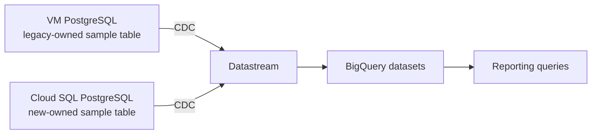

# Lab 03: operational PostgreSQL to BigQuery

**Question:** How do multiple service databases feed near-real-time reporting without analytical reads slowing down booking and payment writes?

## Architecture



Use the two PostgreSQL sources from Lab 01. The Terraform here provisions a BigQuery dataset and Datastream connection/stream resources in the same region. Source database passwords live in Secret Manager versions created outside Terraform; Terraform stores only their resource names. The streams use private VPC connectivity and different publication/replication slots. The BigQuery destination is for analytics, not a transactional source of truth.

## Exercise

1. Decide which fields reporting actually needs. Exclude payment secrets and unnecessary personal data. Create separate reporting views for bookings and refunds, and explain how late-arriving or corrected source events affect totals.
2. Prepare a publication and replication slot for each source. Add database passwords to the empty Secret Manager secrets through an approved interactive process; do not write them into Terraform state. Review the Datastream service agent's access to only those secrets.
3. Review the Terraform plan and, after separate approval, start the streams. Insert and update rows in both source databases; compare BigQuery row counts and freshness with source counts. Test delete behavior and understand whether the chosen BigQuery mode exposes current state or history.
4. Pause one source, generate changes, then resume it. Measure lag, missing rows during the pause, catch-up time, and any replication-slot WAL growth. Explain how reporting marks data as stale rather than presenting an incomplete total as current.
5. Run an aggregation such as bookings and refunds by day. Compare the result with source-side counts and document any delay or deduplication rule.

**Pass evidence:** A source-to-destination mapping, two count/freshness checks, one late-update check, and a dashboard/reporting caveat for stale data. Explain why a cross-service business metric may need stable IDs and a defined event-time policy.

**Interview prompts:** What happens if analytics falls behind during a rainy cancellation burst? Which reports can tolerate delay? How does the pipeline avoid load on primary databases? How do you protect PII and payment data? What is the cost of CDC, BigQuery storage, and query scans?

## Terraform boundary

Lab 01's VPC and databases must exist before this lab's streams can run. Pass its output values explicitly; do not use a remote-state data source or a default project. The source secrets require manually added versions before Datastream profiles can connect.

```sh
terraform -chdir=labs/03-analytics/terraform init -backend=false
terraform -chdir=labs/03-analytics/terraform plan -var-file=../../../terraform/terraform.tfvars -var-file=terraform.tfvars
```

The second file is local and ignored; it contains only non-secret source IPs and network IDs. Review the plan and cost guardrails before each apply. Destroy Datastream streams and private connections before destroying Lab 01 networking, and check for remaining resources afterward.

## Sources

- [Datastream sources](https://docs.cloud.google.com/datastream/docs/sources)
- [Datastream to BigQuery](https://docs.cloud.google.com/datastream/docs/configure-bigquery-destination)
- [PostgreSQL CDC preparation](https://docs.cloud.google.com/datastream/docs/configure-your-source-postgresql-database)
